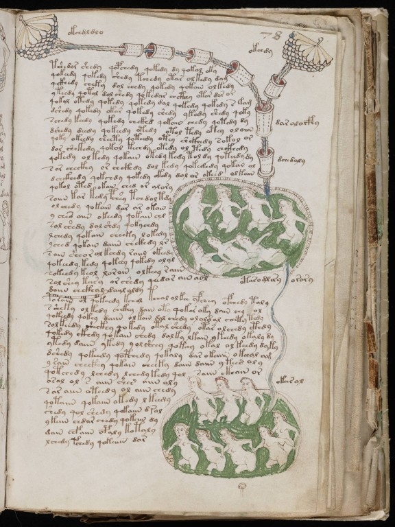

# Voynich: até onde chega um agente de IA

Este é um experimento. A pergunta era: até onde um agente de inteligência artificial chega tentando decifrar o Manuscrito Voynich, se for obrigado a trabalhar com método, testar cada ideia e contar os resultados com honestidade?

> ## ⚠️ O texto NÃO foi decifrado.
>
> Nenhuma tradução saiu daqui. O que saiu foi uma investigação: o que o texto *não* é, o que ele provavelmente é, e com que grau de certeza.
>
> | Afirmação | Confiança hoje | Em linguagem comum |
> |---|---|---|
> | Encontramos a chave do código | menos de 1% | Não encontramos. |
> | Temos uma tradução válida | menos de 1% | Não temos. |
> | O texto foi produzido por regras, sem uma língua escondida nas palavras | cerca de 70% | É a melhor explicação, mas não está provada. Em dez casos parecidos, acertaríamos uns sete. |
> | Pelas figuras, o livro é sobre ervas, banhos e astrologia médica | cerca de 35% | Plausível, mas as figuras também enganam. |
> | O texto contém de verdade a informação das figuras | 9 a 14% | Pouco provável, pelo que testamos. |
> | A cifra "Naibbe", proposta em 2025, gerou o manuscrito | até 1% | Testamos a cifra exatamente como o autor publicou. Ela não gera um texto como o do manuscrito. |

**Atalhos:** [Diário fase a fase](DIARIO.md) · [As 18 fases](docs/fases/) · [Glossário](docs/glossario.md) · [Relatório técnico completo](docs/relatorio_completo.md) · [Prompts usados](docs/prompts.md) · [Código](src/) · [Resultados](results/) · [Onde baixar os dados](DADOS.md)

---

## O que é o Manuscrito Voynich, e por que ninguém o leu

É um livro escrito à mão, com cerca de 240 páginas, guardado na Biblioteca Beinecke da Universidade Yale (EUA), sob o código MS 408. O pergaminho foi datado por carbono-14 entre 1404 e 1438. O nome vem de Wilfrid Voynich, o livreiro que o comprou em 1912.

O livro é cheio de desenhos: plantas que ninguém identificou com certeza, mulheres em banheiras ligadas por canos, círculos com signos do zodíaco, diagramas de estrelas. E é todo escrito num alfabeto que não existe em nenhum outro lugar.

|  |  |  |
|---|---|---|
| **f2r**: uma planta com rótulo. A chave foi testada nela na [Fase 4](docs/fases/fase-04.md). | **f71r**: Áries no zodíaco. Embaixo do carneiro, alguém escreveu *abril* em letra latina. Também na [Fase 4](docs/fases/fase-04.md). | **f78r**: banheiras ligadas por canos. Uma das páginas do teste decisivo da [Fase 5](docs/fases/fase-05.md). |

Imagens: Beinecke Rare Book & Manuscript Library, Yale University, MS 408. O manuscrito é de domínio público, e Yale libera as imagens digitais de obras em domínio público. O livro completo pode ser visto na [Beinecke](https://beinecke.library.yale.edu/collections/highlights/voynich-manuscript) ou no [Internet Archive](https://archive.org/details/voynich_MS_408).

Ninguém conseguiu ler. Já tentaram decifradores de guerra, linguistas, matemáticos, amadores e, mais recentemente, computadores. O problema começa antes da tradução: ninguém sabe nem *em que língua* o texto está. Pode ser uma língua real com letras inventadas. Pode ser um código. Pode ser um texto que imita escrita, mas não diz nada.

## O que este experimento tentou

Pedi a um agente de IA (Claude, da Anthropic) que fizesse a sua própria tentativa, do zero, com regras rígidas:

- Citar só trechos que existem de verdade no manuscrito, com página e linha. Nada inventado.
- Fixar as regras da "chave" antes de ler, e não ajustar palavra por palavra para forçar um sentido.
- Separar sempre o que é resultado do método do que é palpite.
- Testar cada ideia com controles: provas montadas para mostrar se o método se engana sozinho.

A tentativa começou como um desafio de 7 etapas e virou uma investigação de 18 fases. Cada fase nasceu de uma pergunta que a anterior deixou em aberto.

O agente trabalhou sobre uma transcrição digital do manuscrito: cada símbolo foi trocado por letras comuns num padrão chamado EVA, criado por pesquisadores do Voynich. As imagens das páginas serviram só para olhar os desenhos.

## O que descobrimos até agora

Cada item abaixo veio de um teste que poderia ter dado o resultado contrário.

1. **O espaço entre as "palavras" não funciona como numa língua.** Numa língua, o começo e o fim de uma palavra estão ligados entre si. No Voynich, o fim de uma palavra está mais ligado ao começo da *seguinte*. Parece um texto corrido cortado em pedaços do tamanho de sílabas, com uma regra de emenda entre um pedaço e o próximo.
2. **Um sinal no fim da linha é uma abreviatura de margem.** Palavras terminadas em `-m` aparecem quando falta espaço na margem direita, no lugar de terminações mais longas, como os copistas medievais faziam com abreviaturas.
3. **Há dois "dialetos" de escrita, e eles coincidem com escribas diferentes.** Não parecem duas línguas. Parecem dois hábitos de grafia.
4. **Nenhuma tabela de correspondência fixa lê o texto, em seis línguas.** Latim, italiano, alemão, catalão, francês antigo e occitano. O teste tinha força para enxergar uma cifra assim: em textos cifrados de propósito, ele dava uma diferença de 33 a 54 pontos. No Voynich, a diferença nunca passou de 1,7.
5. **O texto não acompanha as figuras.** Páginas com plantas parecidas não têm texto parecido. Nenhuma palavra aparece justamente nas páginas com flor azul ou raiz vermelha. O teste acharia uma palavra assim em 86 a 90% das vezes.
6. **Um gerador com seis regras simples, sem mensagem nenhuma, imita quase tudo o que medimos.** Isso inclui o jeito como as palavras se agrupam em trechos de páginas, desde que o vocabulário do "escriba" mude devagar ao longo da cópia.
7. **A cifra Naibbe, proposta em 2025, não explica o manuscrito.** Ela foi publicada como capaz de transformar latim em algo parecido com o Voynich. Usamos o código e as tabelas do próprio autor, sem mudar nada. A cifra funciona (cifra e decifra latim com 100% de acerto), mas o texto que ela produz não tem palavras estáveis, nem o vocabulário do manuscrito, nem a ligação entre palavras vizinhas.

**Em resumo:** a explicação mais simples para os dados é um texto escrito por regras, com aparência de escrita silábica, num livro ilustrado de ervas, banhos e astrologia médica. Ainda há espaço para uma notação com significado que nenhum dos nossos testes pegou.

## Como o trabalho foi feito: um trabalho de detetive

Não dá para "traduzir" um texto sem saber o que ele é. Então o trabalho foi de detetive: juntar pistas, listar suspeitos, testar cada um e descartar quem tem álibi.

| Etapa | O que foi feito | Analogia do dia a dia |
|---|---|---|
| **Examinar a cena** (Fase 1) | Contar símbolos, medir onde cada um aparece na palavra, comparar seções e escribas | O detetive mede as pegadas *antes* de ter suspeitos, para não ver só o que quer ver |
| **Listar suspeitos** (Fase 2) | Três explicações concorrentes; escolher a que explica mais pistas | Fazer a lista de quem tinha motivo e oportunidade |
| **Testar a chave na fechadura** (Fases 3 a 5) | Montar uma chave com regras fixas, aplicar e comparar com o mesmo texto embaralhado | Se a chave "abre" igual qualquer fechadura, ela não é a chave. É como um remédio que precisa funcionar melhor que o placebo |
| **Testar o detector antes de procurar** (Fases 3, 8 e 9) | Cifrar um latim de verdade com uma chave conhecida e ver se o método a encontra | Enterrar uma moeda na areia de propósito, para ver se o detector de metais apita |
| **Chamar um falsificador** (Fases 10 e 15) | Construir um gerador de texto sem mensagem e ver o que ele consegue imitar | Se um falsificador sem mensagem nenhuma imita o padrão, o padrão não prova que existe mensagem |
| **Conferir a legenda com a foto** (Fases 11 e 12) | Medir as cores dos desenhos e ver se o texto acompanha | Se a legenda fala de flores azuis, ela deveria aparecer nas fotos de flores azuis |
| **Reproduzir o experimento do colega** (Fases 16 e 18) | Rodar a cifra Naibbe com o código e as tabelas do autor | Antes de discordar de alguém, refazer o experimento dele com o equipamento dele |
| **Anotar o palpite antes do jogo** (Fase 18) | Escrever o critério de decisão antes de rodar o teste | Lacrar o palpite num envelope antes da partida, para não "acertar" depois |
| **Chamar um advogado do diabo** (Fase 18) | Um agente "Cético", que não viu o raciocínio, recebe só as tabelas e tenta derrubar a conclusão | Um revisor de fora, que não se apegou à teoria, encontra o que o autor deixou passar |

Na Fase 18, o trabalho foi dividido entre vários agentes de IA ao mesmo tempo: um coordenador e quatro auxiliares (Cifrador, Comparador, Controle e Cético). Todos usaram um único código de medidas, para que as diferenças viessem dos dados e não de implementações diferentes.

## O que não funcionou

Esta seção tem o mesmo peso da anterior. É ela que mostra que os testes podiam falhar, e falharam.

- **A hipótese inicial caiu.** A primeira aposta foi que cada "palavra" do Voynich seria uma sílaba de latim. A chave construída para isso lia o texto embaralhado tão bem quanto o original: 23,0% de palavras "válidas" contra 22,5%. Um latim cifrado de verdade daria cerca de 77% contra 48%.
- **Os dois primeiros métodos de achar a chave falharam.** O primeiro degenerou: o texto inteiro virava *a, e, an, en, ne*. O segundo não teria encontrado a chave nem num texto cifrado de propósito, com chave conhecida (acertou 1 ou 2 de 39 valores). Os dois foram descartados e estão registrados.
- **Uma regra da chave estava errada.** A ideia de que `k` e `t` (e `ch` e `sh`) seriam a mesma letra escrita de dois jeitos não se sustentou: a proporção entre eles muda com o assunto dentro da mão do mesmo escriba.
- **Seis línguas, tabelas por dialeto: nada.** Nenhuma combinação abriu diferença entre o texto real e o embaralhado.
- **A tradução não serviu para nada.** As "palavras lidas" eram pronomes e partículas soltos (*sunt, eius, eis, et*), sem uma frase. A melhor frase obtida, *et eis cis* ("e, a eles, aquém"), não prova nada.
- **Os geradores sem mensagem falharam por muito tempo.** 27 variações não reproduziram o agrupamento por trechos sem quebrar outra medida. Só na Fase 15 um gerador conseguiu.
- **A minha primeira versão da cifra Naibbe era simplificada demais** (Fase 16). Só a versão do autor, testada na Fase 18, vale como teste dela.
- **Na Fase 18, o critério de decisão escrito antes não tinha poder.** O agente Cético mostrou que a régua também reprovaria o próprio latim sem cifra e até o manuscrito. A conclusão automática foi suspensa e o teste foi refeito com um critério melhor. Na segunda rodada, o Cético achou mais quatro erros nos testes corretivos, e todos foram corrigidos.
- **O nosso próprio modelo de regras falha numa medida.** Ele produz poucas palavras que aparecem uma única vez, comparado ao manuscrito. Isso está registrado como problema aberto, não escondido.

## Quem fez o quê

**Eu (Matheus Cremer)** desenvolvi todo o processo de prompts para obter os melhores resultados da pesquisa e administrei a coordenação dos agentes e subagentes: defini as perguntas, decidi quando continuar, o que testar a seguir e quando discordar de trabalhos anteriores.

**Os agentes de IA (Claude, da Anthropic)** fizeram a análise, o código e os relatórios, sob a minha direção. Cada um teve um papel:

| Agente | Função |
|---|---|
| **Orientador** (uma conversa separada do Claude) | O "coordenador do coordenador". Comigo, planejou as etapas, ajudou a redigir os prompts e sugeriu como organizar o trabalho em vários agentes. Não tocou nos dados. |
| **Agente principal** (Fases 1 a 17) | Fez a investigação de ponta a ponta: medições, hipóteses, chave, testes, geradores, relatórios e código. |
| **Coordenador** (Fase 18) | O mesmo agente principal, em outro papel: escreveu o código único de medidas, registrou os critérios antes de rodar, distribuiu as tarefas, juntou os resultados e corrigiu o que o Cético apontou. |
| **Cifrador** (subagente) | Cifrou textos latinos e italianos com a cifra Naibbe e mediu o resultado. |
| **Comparador** (subagente) | Mediu o manuscrito por dialeto, seção e escriba, e montou a "régua" de comparação. |
| **Controle** (subagente) | Mediu o modelo de texto gerado por regras e o manuscrito embaralhado. |
| **Cético** (subagente) | Recebeu só as tabelas e a conclusão, sem o raciocínio, e tentou derrubá-la. Fez duas rodadas de críticas. |

Todos os prompts estão em [docs/prompts.md](docs/prompts.md).

## Como reproduzir

Todo o código está em [`src/`](src/), com instruções em [`src/README.md`](src/README.md). É Python 3, com `numpy`, `scipy`, `pandas` e `Pillow`.

1. Baixe os dados externos indicados em [DADOS.md](DADOS.md). Eles não vêm no repositório porque pertencem a outras pessoas.
2. Coloque as transcrições em `src/ZL.txt` e `src/RF.txt`, e os textos de comparação em `dados_externos/`.
3. Rode os scripts de dentro de `src/` com `PYTHONHASHSEED=0`, para obter exatamente os mesmos números.

Antes da publicação, refizemos a partir de uma cópia limpa as Fases 1, 5, 8 (espaço), 11, 12 e 18 (cifra e métricas). Os resultados saíram idênticos aos guardados em [`results/`](results/).

## Fontes

- **O manuscrito:** Beinecke Rare Book & Manuscript Library, Yale University, MS 408. [Página da Beinecke](https://beinecke.library.yale.edu/collections/highlights/voynich-manuscript).
- **Transcrições:** ZL3b (Zandbergen–Landini) e RF1b, em formato IVTFF, do site de René Zandbergen, [voynich.nu](https://www.voynich.nu/transcr.html).
- **Cifra Naibbe:** Greshko, Michael A. (2025). "The Naibbe cipher: a substitution cipher that encrypts Latin and Italian as Voynich Manuscript-like ciphertext". *Cryptologia*. [doi:10.1080/01611194.2025.2566408](https://doi.org/10.1080/01611194.2025.2566408). Código: [github.com/greshko/naibbe-cipher](https://github.com/greshko/naibbe-cipher).
- **Textos de comparação:** Latin Library (cópia do CLTK), Europarl (NLTK) e treebanks Universal Dependencies. Detalhes e links em [DADOS.md](DADOS.md).

O código deste repositório está sob a licença MIT ([LICENSE](LICENSE)).
