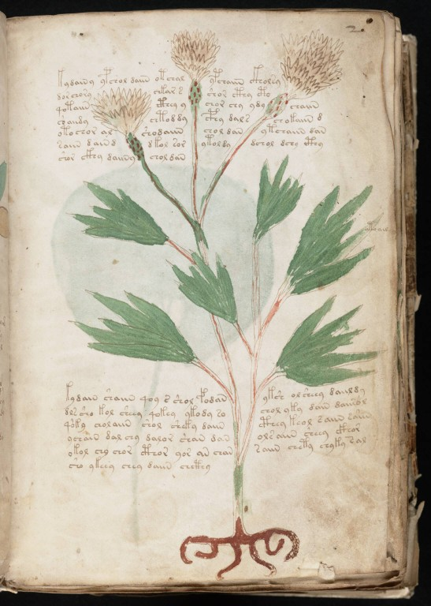
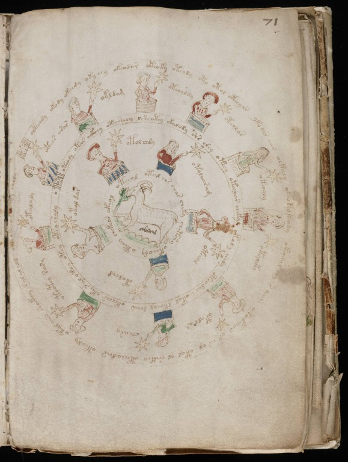

# Fase 4 – Aplicar a chave

[← Fase 3](fase-03.md) · [Diário](../../DIARIO.md) · [README](../../README.md) · [Fase 5 →](fase-05.md)

> **Em uma frase:** A chave congelada aplicada, linha a linha, a quatro trechos pedidos no desafio.

|  |  |
|---|---|
| Fólio 2r, a página de planta da Fase 4 | Fólio 71r, Áries no zodíaco, com *abril* em letra latina |

Imagens: Beinecke Rare Book & Manuscript Library, Yale University, MS 408 (domínio público).

**A pergunta.** O que a chave produz quando aplicada a trechos reais, e isso combina com as figuras?

**O que foi feito.** A chave foi aplicada ao primeiro parágrafo do livro (f1r), a uma página de planta com rótulo (f2r), aos rótulos de uma página do zodíaco (f71r) e a um parágrafo de receitas (f103r). Cada palavra foi marcada como lida, incerta ou não resolvida, e as leituras foram conferidas com os desenhos.

**O que deu.** Entre 0% e 32% das palavras viraram formas latinas, quase sempre pronomes e partículas soltos (eius, eis, sunt, et). Nenhuma frase gramatical. Nenhuma palavra de planta na página de planta, nenhum nome de estrela no zodíaco. A melhor sequência foi 'et eis cis' ('e, a eles, aquém').

**Por que importa.** O resultado já parecia ruído. A Fase 5 fez o teste que decide.

- **Código:** [`fase4.py`](../../src/fase4.py), [`tabelas.py`](../../src/tabelas.py)
- **Saídas:** [`results/fase-04/`](../../results/fase-04/)

Termos técnicos estão explicados no [glossário](../glossario.md).

---

## Texto técnico (trecho do relatório completo)

### Fase 4 – Tradução

Legenda: ✓ lida, ? incerta, ✗ não resolvida. ∅ marca uma palavra que não decodifica (algum pedaço não tem valor). Na coluna intermediária, as formas atestadas estão em negrito, e o sinal + junta palavras Voynich que formaram uma só palavra latina. Quando o ZL e o RF divergem, adotei sempre o ZL, com a vírgula valendo espaço, e cito abaixo de cada tabela as divergências que mudam a leitura.

**a) f1r, primeiro parágrafo (linhas 1 a 6)**

| Linha | EVA | Forma intermediária (latim decodificado) | Português |
|---|---|---|---|
| f1r.1 | fachys ykal ar ataiin shol shory cthres y.kor sholdy | luepet · otuus · us · utunt · **eius** · eimis · cmret · **is+tis** · einum | —✗ · —✗ · —✗ · —✗ · dele✓ · —✗ · —✗ · a-estes✓ · —✗ |
| f1r.2 | sory ckhar or y kair chtaiin shar ase cthar cthar dan | gimis · cus · as · **is** · **tum** · etunt · eus · ∅ · cus · cus · suen | —✗ · —✗ · —✗ · ele/vais✓ · então✓ · —✗ · —✗ · —✗ · —✗ · —✗ · —✗ |
| f1r.3 | syaiir sheky or ykaiin shod cthoary cthes daraiin sy | gpur · ertis · as · otunt · eiam · ciumis · cret · **sumunt** · gis | —✗ · —✗ · —✗ · —✗ · —✗ · —✗ · —✗ · tomam✓ · —✗ |
| f1r.4 | soiin oteey oteos roloty cthiar daiin okaiin or okan | gint · atdis · atriet · minitis · ∅ · **sunt** · atunt · as · atuen | —✗ · —✗ · —✗ · —✗ · —✗ · são✓ · —✗ · —✗ · —✗ |
| f1r.5 | sair y chear cthaiin cphar cfhaiin | gum · **is** · erus · cunt · cus · cunt | —✗ · ele/vais✓ · —✗ · —✗ · —✗ · —✗ |
| f1r.6 | ydaraishy | ∅ | —✗ |

Palavras: 46. Lidas 8 (17%), incertas 0 (0%), não resolvidas 38 (83%).

Divergências. Em f1r.5, o ZL tem `sair,y`, que dá *gum* + *is* (✓); o RF tem `sairy`, que dá *gubis* (✗). Em f1r.2, o ZL tem `or,y` (*as* + *is*), e o RF `ory`, que dá *amis* (✗). Em f1r.1, o ZL traz `[cth:oto]res` (adotei `cth`) e o RF `ctoses`; nenhuma das duas resolve. Lido em sequência, o parágrafo dá "dele … a estes / ele … então / … tomam / … são / … ele". Não sai uma oração.

**b) f2r, página herbal com rótulo e desenho**

| Linha | EVA | Forma intermediária (latim decodificado) | Português |
|---|---|---|---|
| f2r.1 | kydainy ypchol daiin otchal ypchaiin ckholsy | ∅ · oleius · **sunt** · ateuus · oleunt · cingis | —✗ · —✗ · são✓ · —✗ · —✗ · —✗ |
| f2r.2 | dorchory chkar s shor cthy {cto} | simeimis · etus · **et** · **eis** · **cis** · ∅ | —✗ · —✗ · e✓ · a-eles✓ · aquém✓ · —✗ |
| f2r.3 | qotaiin cthey y chor chy ydy chaiin | quitunt · cris · **is** · **eis** · **eis** · oum · **eunt** | —✗ · —✗ · ele/vais✓ · a-eles✓ · a-eles✓ · —✗ · vão✓ |
| f2r.4 | {c'o}aiidy chtod dy cphy dals chokaiin d | ∅ · **etiam** · um · **cis** · sunet · eitunt · am | —✗ · também✓ · —✗ · aquém✓ · —✗ · —✗ · —✗ |
| f2r.5 | otochor al shodaiin chol dan ytchaiin dan | atieis · uus · eisunt · **eius** · suen · oteunt · suen | —✗ · —✗ · —✗ · dele✓ · —✗ · —✗ · —✗ |
| f2r.6 | saiin dain d dkol sor ytoldy dchol dchy cthy | gunt · suit · am · stius · gis · otinum · seius · seis · **cis** | —✗ · —✗ · —✗ · —✗ · —✗ · —✗ · —✗ · —✗ · aquém✓ |
| f2r.7 | shor ckhy daiiny chol dan | **eis** · **cis** · ∅ · **eius** · suen | a-eles✓ · aquém✓ · —✗ · dele✓ · —✗ |
| f2r.8 | kydain shaiin qoy s shol fodan yksh olsheey daiildy | tpsuit · **eunt** · quiis · **et** · **eius** · lisuen · ∅ · anedis · ∅ | —✗ · vão✓ · —✗ · e✓ · dele✓ · —✗ · —✗ · —✗ · —✗ |
| f2r.9 | dls sho kol sheey qokey ykody so chol yky dain daiisol | snet · **ei** · tius · **edis** · quitris · **otium** · gi · **eius** · otis · suit · ∅ | —✗ · a-ele✓ · —✗ · do-templo/comes✓ · —✗ · ócio✓ · —✗ · dele✓ · —✗ · —✗ · —✗ |
| f2r.10 | qo'ky cholaiin shol sheky daiin cthey keol saiin e'a'iin | ∅ · einunt · **eius** · ertis · **sunt** · cris · trius · gunt · ∅ | —✗ · —✗ · dele✓ · —✗ · são✓ · —✗ · —✗ · —✗ · —✗ |
| f2r.11 | ychain dal chy dalor shan dan olsaiin sheey ckhor | oeuit · **suus** · **eis** · sunis · euen · suen · angunt · **edis** · **cis** | —✗ · seu✓ · a-eles✓ · —✗ · —✗ · —✗ · —✗ · do-templo/comes✓ · aquém✓ |
| f2r.12 | okol chy chor cthor yor an chan saiin chety chyky sal | atius · **eis** · **eis** · **cis** · ois · uen · euen · gunt · ertis · eptis · guus | —✗ · a-eles✓ · a-eles✓ · aquém✓ · —✗ · —✗ · —✗ · —✗ · —✗ · —✗ · —✗ |
| f2r.13 | sho ykeey chey daiin chcthy | **ei** · otdis · **eris** · **sunt** · ecis | a-ele✓ · —✗ · serás✓ · são✓ · —✗ |
| f2r.14 (rótulo) | ytoail | ∅ | —✗ |
| f2r.15 (rótulo) | ios an on | ∅ · uen · aen | —✗ · —✗ · —✗ |

Palavras: 105. Lidas 34 (32%), incertas 0 (0%), não resolvidas 71 (68%).

Conferência no PDF. A planta tem três cabeças de flor com brácteas e florzinhas cor de palha (como uma centáurea ou um cardo), folhas recortadas em lobos pontudos, caule avermelhado e raiz vermelha ramificada. O rótulo `ytoail` está na ponta de uma folha do lado direito. A leitura não combina com a figura. O rótulo fica não resolvido, porque o último pedaço (`il`) não tem valor. O texto vira uma sopa de pronomes e verbos de ligação (*eius, eis, sunt, cis, et*), sem nenhuma palavra de planta (*herba, folium, flos, radix, semen*). O segundo rótulo (`ios.an.on`) não consegui localizar na imagem, nesta resolução, e ele também não resolve.

Divergências. Em f2r.4, o ZL tem `chtod,dy` (*etiam* + *um*) e o RF `chtoddy` (*etisum*, ✗); portanto o *etiam* depende de uma vírgula. Em f2r.9, o ZL tem `dls,sho` (… + *ei* ✓) e o RF `dlssho` (✗); o ZL tem `chol,yky` (*eius* ✓ + *otis*) e o RF `cholyky` (✗). Diferenças só entre `k` e `t`, como `chokaiin`/`chotaiin`, desaparecem pela R1.

**c) f71r, rótulos do zodíaco (Áries claro)**

| Linha | EVA | Forma intermediária (latim decodificado) | Português |
|---|---|---|---|
| f71r.2 (rótulo) | oteos arar | atriet · umus | —✗ · —✗ |
| f71r.3 (rótulo) | okldam | atnsuer | —✗ |
| f71r.4 (rótulo) | oteoaldy | atriunum | —✗ |
| f71r.5 (rótulo) | oteolar | atrinus | —✗ |
| f71r.6 (rótulo) | okeoaly | atriunis | —✗ |
| f71r.7 (rótulo) | otaleky | atunrtis | —✗ |
| f71r.8 (rótulo) | otalsar | atungus | —✗ |
| f71r.9 (rótulo) | cheary | erumis | —✗ |
| f71r.10 (rótulo) | oteotey rary | atritris · mumis | —✗ · —✗ |
| f71r.11 (rótulo) | otalaly | atununis | —✗ |
| f71r.13 (rótulo) | otolchdy | atineum | —✗ |
| f71r.14 (rótulo) | otoloaram | atiniumuer | —✗ |
| f71r.15 (rótulo) | oteeol | atdius | —✗ |
| f71r.16 (rótulo) | otolchd | atineam | —✗ |
| f71r.17 (rótulo) | otaldar | atunsus | —✗ |

Palavras: 17. Lidas 0 (0%), incertas 0 (0%), não resolvidas 17 (100%).

Conferência no PDF. No centro há um carneiro claro, e embaixo dele está escrito *abril* em letra latina, por outra mão. Há 15 figuras femininas em dois anéis (10 por fora, 5 por dentro), a maioria dentro de tinas listradas, cada uma segurando uma estrela; o rótulo sai da estrela. Não combina: nenhum dos 15 rótulos é lido. Todos começam por *at-* (o `o-` inicial vale *a* e `t` vale *t*), que é o prefixo `ot-`/`ok-` do quinto padrão. O resto não forma nome de estrela, número nem dia. Divergências: em f71r.10, o ZL tem `oteotey.rary` e o RF `oteokey.sary` (a primeira palavra fica igual pela R1; *mumis*/*gumis*, ambas ✗). Em f71r.17, o ZL tem `otaldar` (✗) e o RF `otal.dar`, onde `dar` sai *sus*, "porco" (✓). É exatamente o tipo de acerto casual que a R5 impede de virar interpretação.

**d) f103r, sexto parágrafo da seção de receitas (linhas 18 a 20)**

| Linha | EVA | Forma intermediária (latim decodificado) | Português |
|---|---|---|---|
| f103r.18 | polchedy qokeol okain checthy oteeylshedy okain qokain qokalshedy oteys | linerum · quitrius · atuit · ercis · atdpnerum · atuit · quituit · quitunerum · atrpet | —✗ · —✗ · —✗ · —✗ · —✗ · —✗ · —✗ · —✗ · —✗ |
| f103r.19 | okaiin chey qoy shey qokaiin chedy qokain oteol lkar okaral lkldy lr | atunt · **eris** · quiis · **eris** · quitunt · **erum** · quituit · atrius · ntus · atumuus · ntnum · ns | —✗ · serás✓ · —✗ · serás✓ · —✗ · o-senhor? · —✗ · —✗ · —✗ · —✗ · —✗ · —✗ |
| f103r.20 | ychain shckhy qokaiin shey qokaiin shedy olor | oeuit · ecis · quitunt · **eris** · quitunt · **erum** · anis | —✗ · —✗ · —✗ · serás✓ · —✗ · o-senhor? · —✗ |

Palavras: 28. Lidas 3 (11%), incertas 2 (7%), não resolvidas 23 (82%).

f103r é uma página só de texto, com uma estrela na margem esquerda marcando cada parágrafo; este é o sexto. Divergências: `qokalshedy`/`qotalshedy` (f103r.18) e `okaral`/`otaral` (f103r.19) ficam iguais pela R1. `oteol`/`oteal` (f103r.19) dão *atrius*/*atruus*, ambas ✗.

---

[← Fase 3](fase-03.md) · [Diário](../../DIARIO.md) · [README](../../README.md) · [Fase 5 →](fase-05.md)
